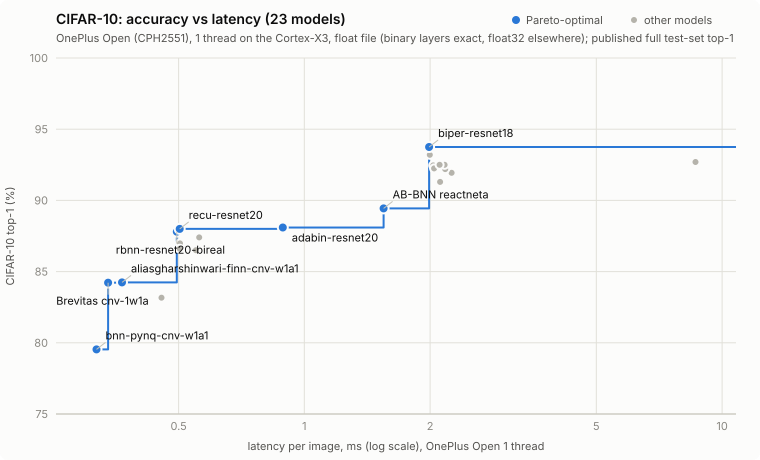
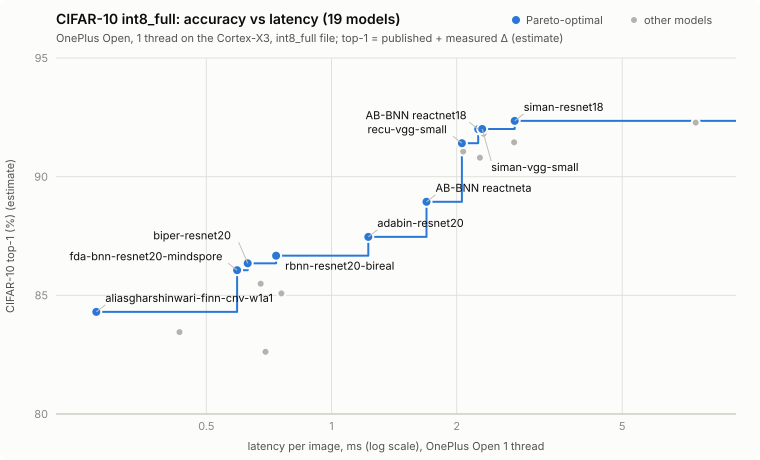

<p align="center"></p>

<h1 align="center">Bitino</h1>
<p align="center"><i>1-bit neural networks that keep your phone cool.</i><br>
by Fred · <a href="https://federicofontana.dev">federicofontana.dev</a></p>

Bitino runs **binary neural networks** (BNNs) on the CPU of an Android phone or a laptop: a dependency-free C++17
runtime with NEON (ARMv8.2 dotprod, i8mm) and AVX2 / AVX-VNNI kernels, converters that take networks from their
**original** published checkpoints, a full-integer int8 path, and a curated zoo of every BNN we could find with
public weights.

<!-- generated:stats -->
**326** binary networks investigated, **206** with verified public weights, **114** converted and validated against their original framework, **11** redistributable as converted files (explicit permissive weights licence). Fetch recipes: 4 verified end to end, 110 reconstructed from the conversion records.
<!-- /generated:stats -->

*Un bitino* is Italian for “a little bit”, which is all a binary network needs per weight.

## Why binary networks, why Bitino

* **Small and cool.** A binary convolution is `XNOR` + `popcount` on packed bits: 32 weights per 32-bit word,
  ~1/32 of the weight memory, and far less energy per operation than float multiply-adds. Phones run them on the
  CPU, without an NPU driver and without heating up.
* **Real models, not toy ones.** BNN research is spread over a dozen frameworks (Larq/Keras, PyTorch, OpenVINO,
  ONNX, Brevitas, MindSpore, Theano…). Bitino converts the authors' own checkpoints, so you get the published
  networks, verified against their source framework.
* **Checked, not trusted.** Every conversion is compared with the original framework in float32 *and* float64;
  every optimized kernel is checked against a scalar reference; every first disagreement between runtime and
  reference is traced to a rounding-scale sign flip (`docs/numerical-correctness.md`).
* **Honest speed numbers.** Timings come only from real hardware (the Android phones in `results/devices.json`,
  an x86-64 host), with date, thread setting and clock state. Emulators are used for correctness and instruction
  counts, never for timings.

## Quickstart: Python

```bash
pip install "bitino[image]"           # native runtime inside the wheel; [image] adds Pillow
```

```python
import bitino

m = bitino.load("ab-bnn-imagenet-reactnet18")    # MIT-licensed weights: converted file from the release, SHA-256 checked
logits = m.predict_image("cat.jpg")              # the model's own preprocessing, then the runtime (numpy in, numpy out)
print(logits.argmax(), m.benchmark(threads=1), "ms on this CPU")
```

[](https://colab.research.google.com/github/fedeloper/bitino/blob/main/examples/colab/bitino_quickstart.ipynb)
classify an image and time it on Colab's CPU (a cloud x86 server, not a phone: the phone numbers are below).
Wheels for Linux x86-64 / aarch64, macOS arm64 and Windows x64, any Python >= 3.10; `predict(x)` takes numpy
arrays in the model's layout (NHWC for images), `stage="neon"` is bit-identical with the reference numpy executor.
From a terminal: `bitino run ab-bnn-imagenet-reactnet18 --image cat.jpg --bench`. API: [docs/python.md](docs/python.md).
Models whose weights licence is not explicitly permissive are converted from their original checkpoint
(`bitino fetch`, below) and then load the same way.

## Five-minute quickstart: from source

```bash
git clone https://github.com/fedeloper/bitino && cd bitino
pip install -e .                      # the `bitino` CLI and Python API (compiles the runtime library with CMake)

# 1. the runtime: build it (CMake + a C++17 compiler), or download bitino_bench from the Releases page
cmake -S . -B build/host -G Ninja -DCMAKE_BUILD_TYPE=Release && cmake --build build/host

# 2. a model: browse the zoo, then fetch one
bitino list --converted --task imagenet
bitino fetch ab-bnn-imagenet-reactnet18 --prebuilt   # converted file from GitHub Releases (permissive licence)
bitino fetch ab-bnn-imagenet-reactnet18              # or: original weights + code, SHA-256 check, local conversion (needs torch)

# 3. run it on x86 and time it
bitino run ab-bnn-imagenet-reactnet18 --random 2
bitino bench ab-bnn-imagenet-reactnet18 --threads 4
bitino validate ab-bnn-imagenet-reactnet18           # runtime vs numpy executor vs source framework
```

**Deploy on Android** (arm64, no root): take `bitino_bench-android-arm64` from the Releases page (or
`scripts/build_android.sh` with the NDK) and

```bash
adb push bitino_bench-android-arm64 /data/local/tmp/bitino_bench
adb push ~/.cache/bitino/models/ab-bnn-imagenet-reactnet18/model.bitino /data/local/tmp/
adb shell /data/local/tmp/bitino_bench --model /data/local/tmp/model.bitino --threads 4 --stage all
```

## In an Android app

<!-- demo GIF: record with android/tools/record_demo.sh (docs/android-deployment.md), then restore:
<p align="center"></p> -->

The Android library (`android/bitino`, an AAR for arm64-v8a and armeabi-v7a, API 24+) wraps the runtime in a small
Kotlin API; `android/demo` is the CameraX app above (bundled ReActNet-18, weights MIT).

```kotlin
// build.gradle.kts: implementation("io.github.fedeloper:bitino-android:0.1.0")   (until published: build the AAR,
// android/gradlew -p android :bitino:publishToMavenLocal, and add mavenLocal())
import io.github.fedeloper.bitino.Bitino

val model = Bitino.load(context, "ab-bnn-imagenet-reactnet18.bitino", threads = 1)   // asset or absolute file path
val scores = model.run(bitmap)                  // resize / crop / normalize exactly as the model's manifest says
val top5 = Bitino.topK(Bitino.softmax(scores), 5)
model.close()
```

The preprocessing reproduces the Python pipeline of each model bit for bit (Pillow resampling included; checked
against the evaluation tensors). Native code can instead link `libbitino.a` and use the C API
(`runtime/include/bitino/bitino_c.h`). Details: [docs/android-deployment.md](docs/android-deployment.md),
[docs/getting-started.md](docs/getting-started.md).

`bitino fetch` downloads the weights from where the authors published them, into a fresh directory, checks their
SHA-256, downloads the authors' model code pinned to the recorded commit, and runs the converter with `python -I`
(checkpoints are read with `torch.load(weights_only=True)` only). The converted file's data section is compared with
the published conversion: `IDENTICAL` means bit-identical weights and constants. Converters run in the source
framework's environment (`envs/`); `bitino fetch` says which one and how to point it there
(`--python larq=/path/to/python`). Without a dataset it generates a small synthetic eval set, which is enough for
conversion and runtime checks (accuracy numbers need the real one).

## Speed (measured on phones)

<!-- generated:speed -->
Median latency of one inference (batch 1) in ms. Main columns: **OnePlus Open (CPH2551)** (Qualcomm Snapdragon 8 Gen 2 (SM8550)); 1 thread = pinned to the fastest core; int8 = the full-integer file (int8_full) where measured, else the int8 kernels on the exact file. Accuracy: the original model in its own framework → Bitino's exact stage, on the small check subset; int8_full Δ: the full-integer file's paired difference against the exact stage. Fastest first.

### CIFAR-10 (23 models)





| model | accuracy (reference → Bitino) | int8_full Δ | OnePlus Open 1 thread | OnePlus Open 4 threads | OnePlus Open int8 1 thread | Galaxy S22 1 thread | moto e13 1 thread | Redmi 9A 1 thread (32-bit) |
|---|---|---:|---:|---:|---:|---:|---:|---:|
| `finn-examples-bnn-pynq-cnv-w1a1` | 85.9% → 85.9% | -0.77 pt | 0.327 ◇ | 0.241 ◇ | – | – | – | – |
| `aliasgharshinwari-finn-cnv-w1a1-cifar10` | 89.8% → 89.8% | +0.06 pt | 0.333 ◇ | 0.313 ◇ | 0.272 ◇ | 0.57 ⚠ | – | – |
| `brevitas-bnn-pynq-cnv-1w1a` | 85.9% → 85.9% | -0.77 pt | 0.337 ◇ | 0.269 ◇ | 0.431 ◇ | – | 1.5 | 3.35 |
| `bnn-pynq-cnv-w1a1-cifar10` | 86.7% → 86.7% | +0.42 pt | 0.339 ◇ | 0.246 ◇ | – | – | – | – |
| `shuaiz-bireal20-cifar10` | 84.4% → 84.4% | -0.55 pt | 0.425 ◇ | 0.489 ◇ | 0.694 ◇ | – | – | – |
| `recu-resnet20-cifar10` | 88.3% → 88.3% | -0.67 pt | 0.539 ◇ | 0.407 ◇ | 0.658 ◇ | – | – | – |
| `biper-resnet20-cifar10` | 86.7% → 86.7% | -0.63 pt | 0.613 ◇ | 0.433 ◇ | 0.629 ◇ | – | – | – |
| `fda-bnn-resnet20-cifar10-mindspore` | 89.8% → 89.8% | -0.55 pt | 0.627 ◇ | 0.516 ◇ | 0.593 ◇ | – | – | – |
| `rbnn-resnet20-cifar10` | 88.3% → 88.3% | -1.01 pt | 0.649 ◇ | 0.481 ◇ | 0.676 ◇ | – | 2.56 | 8.24 |
| `siman-resnet20-cifar10` | 87.5% → 87.5% | -2.32 pt | 0.657 ◇ | 0.595 ◇ | 0.758 ◇ | – | – | – |
| `rbnn-resnet20-bireal-cifar10` | 89.8% → 89.8% | -1.13 pt | 0.661 ◇ | 0.583 ◇ | 0.736 ◇ | – | – | – |
| `ab-bnn-cifar10-reactneta` | 91.4% → 91.4% | -0.50 pt | 1.58 ◇ | 0.941 ◇ | 2.1 ◇ | 2.6 ⚠ | – | – |
| `adabin-resnet20-cifar10` | 91.4% → 91.4% | -0.64 pt | 1.59 ◇ | 1.26 ◇ | 1.23 ◇ | 1.22 ⚠ | – | – |
| `biper-resnet18-cifar10` | 94.5% → 94.5% | -1.94 pt | 2.02 ◇ | 1.09 ◇ | 2.32 ◇ | – | – | – |
| `recu-resnet18-cifar10` | 93.8% → 93.8% | -1.32 pt | 2.04 ◇ | 1.12 ◇ | 2.34 ◇ | – | – | – |
| `biper-vgg-small-cifar10` | 96.1% → 96.1% | -1.40 pt | 2.07 ◇ | 1.11 ◇ | 2.07 ◇ | – | – | – |
| `recu-vgg-small-cifar10` | 96.1% → 96.1% | -0.84 pt | 2.08 ◇ | 1.11 ◇ | 2.06 ◇ | – | – | – |
| `rbnn-vgg-small-cifar10` | 91.4% → 91.4% | -0.50 pt | 2.14 ◇ | 1.14 ◇ | 2.27 ◇ | – | – | – |
| `siman-vgg-small-cifar10` | 95.3% → 95.3% | -0.49 pt | 2.14 ◇ | 1.15 ◇ | 2.3 ◇ | – | – | – |
| `rbnn-resnet18-cifar10` | 94.5% → 94.5% | -0.75 pt | 2.19 ◇ | 1.31 ◇ | 2.75 ◇ | – | – | – |
| `siman-resnet18-cifar10` | 95.3% → 95.3% | -0.15 pt | 2.19 ◇ | 1.31 ◇ | 2.76 ◇ | – | – | – |
| `ab-bnn-cifar10-reactnet18` | 93.8% → 93.8% | +0.06 pt | 2.3 ◇ | 1.24 ◇ | 2.77 ◇ | 3.72 ⚠ | 12.4 | 27.1 |
| `bnas-a-cifar10` | 93.8% → 93.8% | -0.42 pt | 8.71 ◇ | 5.25 ◇ | 7.51 ◇ | – | – | – |

### ImageNet (55 models)


| model | accuracy (reference → Bitino) | int8_full Δ | OnePlus Open 1 thread | OnePlus Open 4 threads | OnePlus Open int8 1 thread | Galaxy S22 1 thread | moto e13 1 thread | Redmi 9A 1 thread (32-bit) |
|---|---|---:|---:|---:|---:|---:|---:|---:|
| `larq-zoo-quicknet-small` | 59.4% → 58.6% | -1.96 pt | 4.9 ◇ | 2.58 ◇ | 6.34 ◇ | 9.26 † | 26.6 | 58.7 |
| `larq-zoo-binary-alexnet` | 28.9% → 28.9% | +0.30 pt | 5.49 ◇ | 2.73 ◇ | 3.08 ◇ | – | – | – |
| `larq-zoo-quicknet` | 66.4% → 66.4% | -0.72 pt | 7.63 ◇ | 4.03 ◇ | 9.23 ◇ | – | 43.4 | 94.6 |
| `larq-zoo-xnornet` | 34.4% → 34.4% | -0.36 pt | 7.84 ◇ | 4.29 ◇ | 4.19 ◇ | – | – | – |
| `dabnn-bireal18-stem` | 58.6% → 58.6% | -0.42 pt | 8.16 ◇ | 4.37 ◇ | 8.84 ◇ | – | – | – |
| `dabnn-bireal18` | 58.6% → 58.6% | +0.16 pt | 10.6 ◇ | 5.65 ◇ | 9.97 ◇ | – | – | – |
| `larq-zoo-birealnet` | 57.8% → – | -0.20 pt | 10.6 ◇ | 5.67 ◇ | 10.0 ◇ | – | 69.3 | 131.8 |
| `bitorch-resnete18-imagenet` | 64.8% → 62.5% | -0.84 pt | 10.6 ◇ | 5.68 ◇ | 8.77 ◇ | – | – | – |
| `larq-zoo-binary-resnet-e18` | 55.5% → 55.5% | -0.92 pt | 10.7 ◇ | 5.71 ◇ | 9.89 ◇ | – | – | – |
| `nncf-resnet18-binarization-dorefa` | 62.5% → 62.5% | +0.14 pt | 10.9 ◇ | 5.8 ◇ | 8.91 ◇ | – | – | – |
| `nncf-resnet18-binarization-xnor` | 61.7% → 61.7% | -0.12 pt | 10.9 ◇ | 5.8 ◇ | 8.95 ◇ | – | – | – |
| `omz-resnet18-xnor-binary-onnx-0001` | 59.4% → 59.4% | -1.20 pt | 11.0 ◇ | 5.83 ◇ | 9.2 ◇ | – | 68.4 | 129.1 |
| `omz-resnet18-xnor-binary-onnx-0001-fp16` | 64.1% → 64.1% | +0.00 pt | 11.0 ◇ | 5.84 ◇ | 9.18 ◇ | – | – | – |
| `snn-subbit-reactnet18-w1a1-imagenet` | 64.8% → 64.8% | -0.20 pt | 11.1 ◇ | 5.8 ◇ | 10.3 ◇ | – | – | – |
| `rbonn-reactnet-resnet18-imagenet` | 65.6% → 65.6% | -0.56 pt | 11.1 ◇ | 5.79 ◇ | 10.3 ◇ | – | – | – |
| `ab-bnn-imagenet-reactnet18` | 65.6% → 64.8% | -0.34 pt | 11.1 ◇ | 5.78 ◇ | 10.2 ◇ | 16.9 ⚠ | 70.6 | 138.5 |
| `snn-subbit-reactnet18-w0.67a1-imagenet` | 64.1% → 64.8% | -0.68 pt | 11.1 ◇ | 5.79 ◇ | 10.3 ◇ | – | – | – |
| `recu-resnet18-imagenet` | 59.4% → 59.4% | -1.74 pt | 11.2 ◇ | 5.99 ◇ | 8.95 ◇ | – | 70.6 | 139.4 |
| `biper-resnet18-imagenet` | 59.4% → 59.4% | -1.86 pt | 11.2 ◇ | 6 ◇ | 8.95 ◇ | – | – | – |
| `siman-resnet18-imagenet` | 54.7% → 54.7% | -4.58 pt | 11.3 ◇ | 6.32 ◇ | 9.65 ◇ | – | – | – |
| `tensorpack-dorefa-alexnet-w1a1-g32` | 46.1% → 46.1% | -0.32 pt | 11.5 ◇ | 5.81 ◇ | 7.72 ◇ | – | – | – |
| `rbnn-resnet18-imagenet` | 53.1% → 53.1% | -0.90 pt | 11.7 ◇ | 6.51 ◇ | 9.62 ◇ | – | – | – |
| `sa-bnn-resnet18-imagenet` | 61.7% → 62.5% | -0.78 pt | 11.9 ◇ | 6.13 ◇ | 9.91 ◇ | – | – | – |
| `larq-zoo-real-to-binary-net` | 64.8% → 64.8% | -1.12 pt | 12.6 ◇ | 6.74 ◇ | 11.4 ◇ | – | – | – |
| `larq-zoo-quicknet-xl-legacy` | 64.1% → 64.8% | -0.92 pt | 13.4 ◇ | 7.57 ◇ | 16.8 ◇ | – | – | – |
| `bi-vit-deit-tiny` | 15.6% → 15.6% | -0.34 pt | 13.6 ◇ | 8.06 ◇ | 16.5 ◇ | 42.1 ⚠ | 69.5 | – |
| `larq-zoo-quicknet-large` | 71.1% → 70.3% | -1.96 pt | 13.6 ◇ | 7.4 ◇ | 16.4 ◇ | – | 74.6 | 157.2 |
| `biper-resnet34-imagenet` | 66.4% → 66.4% | -1.26 pt | 17.6 ◇ | 9.4 ◇ | 16.2 ◇ | – | – | – |
| `ab-bnn-imagenet-reactnet34` | 67.2% → 68.0% | -0.62 pt | 17.6 ◇ | 9.2 ◇ | 17.9 ◇ | 27.0 ⚠ | – | – |
| `recu-resnet34-imagenet` | 68.8% → 68.8% | -4.56 pt | 17.7 ◇ | 9.39 ◇ | 16.2 ◇ | – | – | – |
| `siman-resnet34-imagenet` | 59.4% → 60.9% | -14.10 pt | 18.0 ◇ | 10.1 ◇ | 17.9 ◇ | – | – | – |
| `rbnn-resnet34-imagenet` | 64.1% → 63.3% | -0.52 pt | 18.4 ◇ | 10.3 ◇ | 17.6 ◇ | – | – | – |
| `ab-bnn-imagenet-reactneta` | 66.4% → 65.6% | -0.58 pt | 20.2 ◇ | 10.2 ◇ | 24.4 ◇ | 19.6 ⚠ | – | – |
| `bitorch-densenet28-imagenet` | 59.4% → 59.4% | -0.76 pt | 22.7 ◇ | 11.9 ◇ | 17.7 ◇ | – | – | – |
| `larq-zoo-binary-densenet28` | 60.9% → 60.9% | -0.66 pt | 22.8 ◇ | 12.1 ◇ | 17.8 ◇ | – | – | – |
| `larq-zoo-dorefanet` | 46.1% → 46.1% | -0.64 pt | 23.1 ◇ | 12.0 ◇ | 19.9 ◇ | – | – | – |
| `bnext-tiny` | 69.5% → 68.0% | -3.84 pt | 25.5 ◇ | 13.0 ◇ | 30.4 ◇ | – | 137.1 | 419.6 |
| `larq-zoo-binary-densenet37` | 66.4% → 65.6% | -41.28 pt | 26.6 ◇ | 14.1 ◇ | 24.1 ◇ | – | – | – |
| `larq-zoo-meliusnet22` | 65.6% → 66.4% | -57.38 pt | 26.6 ◇ | 14.0 ◇ | 28.4 ◇ | – | – | – |
| `bnas-d-imagenet` | 60.2% → 60.2% | -54.94 pt | 26.6 ◇ | 15.4 ◇ | 16.3 ◇ | – | – | – |
| `bitorch-meliusnet22-imagenet` | 66.4% → 65.6% | -61.52 pt | 26.7 ◇ | 14.3 ◇ | 23.5 ◇ | – | – | – |
| `bhvit-tiny-binary` | 64.1% → 62.5% | -0.74 pt | 29.2 ◇ | 14.8 ◇ | 45.1 ◇ | 46.6 ⚠ | 148.6 | 636.4 |
| `bhvit-tiny-somefp` | 65.6% → 65.6% | -6.20 pt | 31.7 ◇ | 16.0 ◇ | 44.3 ◇ | 58.8 ⚠ | – | – |
| `bnas-e-imagenet` | 56.2% → 56.2% | -0.92 pt | 32.8 ◇ | 19.0 ◇ | 23.1 ◇ | – | – | – |
| `omz-resnet50-binary-0001` | 72.7% → 73.4% | -0.04 pt | 34.2 ◇ | 17.9 ◇ | 27.0 ◇ | – | – | – |
| `omz-resnet50-binary-0001-fp16` | 71.9% → 73.4% | +0.26 pt | 34.5 ◇ | 18.0 ◇ | 27.0 ◇ | – | – | – |
| `bi-vit-deit-small` | 11.7% → 10.9% | -0.88 pt | 35.3 ◇ | 19.5 ◇ | 42.0 ◇ | 113.1 ⚠ | 182.3 | – |
| `larq-zoo-binary-densenet45` | 60.9% → 61.7% | -43.86 pt | 35.7 ◇ | 19.0 ◇ | 33.9 ◇ | – | – | – |
| `bhvit-small-binary` | 68.8% → 65.6% | – | 45.0 ◇ | 22.6 ◇ | 70.0 ◇ | 85.8 ⚠ | 228.6 | – |
| `bhvit-small-somefp` | 72.7% → 76.6% | -1.90 pt | 47.5 ◇ | 24.3 ◇ | 69.3 ◇ | 106.9 ⚠ | – | – |
| `larq-zoo-binary-densenet37-dilated` | 65.6% → 65.6% | -59.00 pt | 47.5 ◇ | 24.5 ◇ | 41.0 ◇ | – | – | – |
| `bnext-small` | 76.6% → 75.0% | -2.70 pt | 50.7 ◇ | 25.4 ◇ | 57.1 ◇ | – | 270.1 | 787.1 |
| `bnext-middle` | 78.9% → 78.9% | -1.34 pt | 85.2 ◇ | 42.5 ◇ | 98.8 ◇ | – | – | – |
| `bnas-h-imagenet` | 60.2% → 60.2% | +0.08 pt | 107.5 ◇ | 56.6 ◇ | 71.6 ◇ | – | – | – |
| `bnext-large` | 79.7% → 80.5% | -0.88 pt | 188.7 ◇ | 93.4 ◇ | 213.4 ◇ | – | – | – |

### Other tasks (36 models)

| model | task | accuracy (reference → Bitino) | int8_full Δ | OnePlus Open 1 thread | OnePlus Open 4 threads | OnePlus Open int8 1 thread | Galaxy S22 1 thread | moto e13 1 thread | Redmi 9A 1 thread (32-bit) |
|---|---|---|---:|---:|---:|---:|---:|---:|---:|
| `brevitas-bnn-pynq-sfc-1w1a` | mnist | 100.0% → 100.0% | – | 0.003 ◇ | 0.012 ◇ | 0.003 ◇ | – | – | – |
| `bnn-pynq-lfc-w1a1-mnist` | mnist | 100.0% → 100.0% | – | 0.017 ◇ | 0.017 ◇ | 0.017 ◇ | – | – | – |
| `brevitas-bnn-pynq-lfc-1w1a` | mnist | 100.0% → 100.0% | – | 0.017 ◇ | 0.017 ◇ | 0.017 ◇ | – | – | – |
| `finn-examples-cnv-w1a1-gtsrb` | gtsrb | 93.8% → 93.8% | – | 0.328 ◇ | 0.253 ◇ | – | – | – | – |
| `bnn-pynq-cnv-w1a1-gtsrb` | gtsrb | 93.8% → 93.8% | – | 0.338 ◇ | 0.248 ◇ | – | – | – | – |
| `brillsson-quicknet` | non-semantic speech representation | 90.7% → 90.7% | – | 0.995 ◇ | 0.687 ◇ | 0.898 ◇ | – | – | – |
| `ab-bnn-cifar100-reactneta` | cifar100 | 71.9% → 71.9% | -0.31 pt | 1.59 ◇ | 0.953 ◇ | 2.09 ◇ | 2.63 ⚠ | – | – |
| `larqface-quicknet-msceleb` | face-recognition | 99.0% → 99.0% | – | 1.86 ◇ | 1.18 ◇ | 1.7 ◇ | – | – | – |
| `ab-bnn-cifar100-reactnet18` | cifar100 | 69.5% → 69.5% | -0.56 pt | 2.31 ◇ | 1.29 ◇ | 2.77 ◇ | 3.72 ⚠ | – | – |
| `brillsson-binarydensenet28` | non-semantic speech representation | 90.5% → 90.5% | – | 2.52 ◇ | 1.65 ◇ | 2.12 ◇ | – | – | – |
| `brillsson-meliusnet22` | non-semantic speech representation | 91.9% → 91.9% | – | 3.4 ◇ | 2.32 ◇ | 3.1 ◇ | – | – | – |
| `larqface-binarydensenet28-msceleb` | face-recognition | 99.2% → 99.2% | – | 5.58 ◇ | 3.38 ◇ | 4.29 ◇ | – | – | – |
| `larqface-binarydensenet37-msceleb` | face-recognition | 99.2% → 99.2% | – | 6.49 ◇ | 4.04 ◇ | 5.17 ◇ | – | – | – |
| `larqface-binarydensenet45-msceleb` | face-recognition | 99.2% → 99.2% | – | 9.09 ◇ | 5.51 ◇ | 7.1 ◇ | – | – | – |
| `bimatting-bimobilenet-backbone` | imagenet | 55.5% → 55.5% | -22.86 pt | 9.17 ◇ | 5.12 ◇ | 12.6 ◇ | – | – | – |
| `ida-det-bires18-imagenet-backbone` | imagenet | 65.6% → 65.6% | -0.64 pt | 11.1 ◇ | 5.78 ◇ | 10.4 ◇ | – | – | – |
| `larqface-binaryfacenet-msceleb` | face-recognition | 95.1% → 95.1% | – | 16.2 ◇ | 8 ◇ | 16.1 ◇ | – | – | – |
| `bbcu-sr-m-x4` | single-image-super-resolution-x4 | 27.22 dB → 27.22 dB | – | 18.5 ◇ | 8.46 ◇ | 17.7 ◇ | 24.4 ⚠ | – | – |
| `bbcu-sr-m-x2` | single-image-super-resolution-x2 | 31.89 dB → 31.89 dB | – | 18.6 ◇ | 9.57 ◇ | 18.0 ◇ | 25.6 ⚠ | – | – |
| `s2bnn-reacta-distill-only` | imagenet self-supervised representation learning | – → 0.96370 | – | 20.3 ◇ | 10.4 ◇ | 20.2 ◇ | – | – | – |
| `burn-reacta-stage2` | imagenet self-supervised representation learning | – → 0.99615 | – | 20.6 ◇ | 10.6 ◇ | 20.4 ◇ | – | – | – |
| `bsrc2023-binary-sr-x2-v0` | single-image-super-resolution-x2 | 31.88 dB → 31.88 dB | – | 28.2 ◇ | 14.9 ◇ | 16.7 ◇ | – | – | – |
| `bbcu-deblocking` | jpeg-artifact-reduction | 31.33 dB → 31.33 dB | – | 28.8 ◇ | 13.8 ◇ | 28.0 ◇ | 33.1 ⚠ | – | – |
| `bbcu-denoise` | color-image-denoising | 29.74 dB → 29.74 dB | – | 29.2 ◇ | 14.0 ◇ | 28.3 ◇ | 34.0 ⚠ | – | – |
| `bibert-bert-base-sst2` | glue-sst2 | 89.8% → 89.8% | -0.34 pt | 30.5 ◇ | 14.9 ◇ | 36.7 ◇ | – | 169.1 | 351.3 |
| `bbcu-sr-l-x2` | single-image-super-resolution-x2 | 32.03 dB → 32.03 dB | – | 37.9 ◇ | 19.3 ◇ | 20.5 ◇ | 36.6 ⚠ | – | – |
| `bbcu-sr-l-x4` | single-image-super-resolution-x4 | 27.36 dB → 27.36 dB | – | 57.1 ◇ | 25.7 ◇ | 21.7 ◇ | 53.5 ⚠ | – | – |
| `bibert-bert-base-mrpc` | glue-mrpc | 76.6% → 76.6% | +0.98 pt | 57.5 ◇ | 26.3 ◇ | 70.2 ◇ | 148.9 ⚠ | – | – |
| `bibert-bert-base-mnli` | glue-mnli | 61.7% → 61.7% | +0.54 pt | 59.5 ◇ | 27.3 ◇ | 73.5 ◇ | 124.7 ⚠ | – | – |
| `bsrc2023-binary-sr-x4-v0` | single-image-super-resolution-x4 | 27.22 dB → 27.22 dB | – | 62.4 ◇ | 28.1 ◇ | 28.0 ◇ | – | – | – |
| `bibert-bert-base-qqp` | glue-qqp | 83.6% → 83.6% | -0.59 pt | 65.1 ◇ | 30.1 ◇ | 76.8 ◇ | 160.7 ⚠ | – | – |
| `bsrc2023-binary-sr-x4-v1` | single-image-super-resolution-x4 | 27.32 dB → 27.32 dB | – | 75.9 ◇ | 33.9 ◇ | 39.9 ◇ | – | – | – |
| `gsb-deit-s-cifar100-stage2` | cifar100 | 70.3% → 69.5% | -1.99 pt | 87.3 ◇ | 43.6 ◇ | 86.4 ◇ | – | – | – |
| `bsrc2023-binary-sr-x2-v1` | single-image-super-resolution-x2 | 32.22 dB → 32.22 dB | – | 139.3 ◇ | 64.1 ◇ | 107.3 ◇ | – | – | – |
| `brevitas-bnn-pynq-tfc-1w1a` | mnist | 96.9% → 96.9% | – | – | 0.007 ◇ | – | – | – | – |
| `finn-examples-bnn-pynq-tfc-w1a1` | mnist | 96.9% → 96.9% | – | – | 0.007 ◇ | – | – | – | – |

Unmarked = clean (every repeat at full clocks). ◇ = the phone's own power policy held the clock ceiling below the maximum with no thermal event (stock settings, screen off; the ceiling is recorded per run); ⚠ = at least one repeat ran under a thermal CPU-frequency cap (e.g. a phone charging over USB); † = run made before the frequency-cap check existed (caps unknown). Runs per device and validity: Galaxy S22: 185 thermal-throttled, 24 unknown-caps; OnePlus Open: 880 vendor-policy; moto e13: 98 clean; Redmi 9A: 42 clean. 

Every phone with 1 and 4 threads and int8: [docs/SPEED.md](docs/SPEED.md). On-device correctness: Galaxy S22: 381/381 correctness checks passed on 114 models, 2026-11-02 to 2026-11-12 (outputs byte-identical to a validated emulated-ARM or reference-phone run of the same code); OnePlus Open: 425/425 correctness checks passed on 114 models, 2026-11-12 (outputs byte-identical to a validated emulated-ARM or reference-phone run of the same code); moto e13: 449/449 correctness checks passed on 114 models, 2026-11-12 (outputs byte-identical to a validated emulated-ARM or reference-phone run of the same code); Redmi 9A: 190/228 correctness checks passed on 114 models, 2026-11-12 (exact stage bit-identical to the numpy executor, float stage within tolerance of the float64 reference).
<!-- /generated:speed -->

The phones: `results/devices.json`. All runs with their clock state: `results/speed_<device>.json`; x86-64 host
runs (older runtime, labelled): `results/speed_x86.json`. Method: [docs/benchmarking.md](docs/benchmarking.md).

**Against Larq Compute Engine and TensorFlow Lite** (same Larq Zoo weights, 1 thread, batch 1, every runtime pinned
to the same core by one launcher): Bitino is 1.29× faster than LCE 0.16 on a Cortex-X3 (all 11 models, 1.09–1.71×),
1.11× faster on a 32-bit Cortex-A53, and on par on a Cortex-A75, where LCE is 3 % faster on average. TFLite fp32 is
4.7–13× slower than Bitino; TFLite int8 is 1.4–4.8× slower and agrees with the float model on only 45–66 % of top-1
classes. Tables, method, setup differences and raw data: [docs/comparison-lce-tflite.md](docs/comparison-lce-tflite.md).

## Model zoo

Selected models (full table with all converted models: [docs/MODEL_ZOO.md](docs/MODEL_ZOO.md); searchable version on
the website):

<!-- generated:zoo_top -->
| model | task | framework | accuracy (reference → Bitino) | eval set (n) | int8_full Δ vs exact | fastest phone ms (1 thread) | weights licence | release |
|---|---|---|---|---|---|---|---|---|
| `ab-bnn-cifar10-reactnet18` | cifar10-classification | pytorch | 93.8% → 93.8% | cifar10-test-first-128 (128) | +0.06 pt (cifar10-test-first-10000, n=10000) | 2.3 ◇ (OnePlus Open) | MIT (HF card) | yes |
| `ab-bnn-imagenet-reactnet18` | imagenet-classification | pytorch | 65.6% → 64.8% | imagenet-val-subset-128 (128) | -0.34 pt (imagenet-val-subset-5000, n=5000) | 11.1 ◇ (OnePlus Open) | MIT (HF model card metadata 'license: mit'); app | yes |
| `ab-bnn-imagenet-reactnet34` | imagenet-classification | pytorch | 67.2% → 68.0% | imagenet-val-subset-128 (128) | -0.62 pt (imagenet-val-subset-5000, n=5000) | 17.6 ◇ (OnePlus Open) | MIT (HF card) | yes |
| `ab-bnn-imagenet-reactneta` | imagenet-classification | pytorch | 66.4% → 65.6% | imagenet-val-subset-128 (128) | -0.58 pt (imagenet-val-subset-5000, n=5000) | 19.6 ⚠ (Galaxy S22) | MIT (HF card) | yes |
| `bbcu-sr-l-x4` | single-image-super-resolution-x4 | pytorch | 27.36 dB → 27.36 dB | set5-set14-b100-x4-lr32 (64) | – | 53.5 ⚠ (Galaxy S22) | no explicit weights licence (inherits repo licen | – |
| `bhvit-tiny-binary` | imagenet-classification | pytorch | 64.1% → 62.5% | imagenet-val-subset-128 (128) | -0.74 pt (imagenet-val-subset-5000_bhvit, n=5000) | 29.2 ◇ (OnePlus Open) | no explicit weights licence (inherits repo MIT?  | – |
| `bi-vit-deit-tiny` | imagenet-classification | pytorch | 15.6% → 15.6% | imagenet-val-subset-128 (128) | -0.34 pt (imagenet-val-subset-5000_bhvit, n=5000) | 13.6 ◇ (OnePlus Open) | no explicit weights licence (inherits repo Apach | – |
| `bibert-bert-base-sst2` | glue-sst2 | pytorch | 89.8% → 89.8% | sst2-dev-128 (128) | -0.34 pt (sst2-dev-872, n=872) | 30.5 ◇ (OnePlus Open) | no explicit weights licence (inherits repo licen | – |
| `bnext-tiny` | imagenet-classification | pytorch | 69.5% → 68.0% | imagenet-val-subset-128 (128) | -3.84 pt (imagenet-val-subset-5000, n=5000) | 25.5 ◇ (OnePlus Open) | no explicit weights licence (inherits repo Apach | – |
| `brevitas-bnn-pynq-cnv-1w1a` | cifar10-classification | pytorch+brevitas | 85.9% → 85.9% | cifar10-test-first-128 (128) | -0.77 pt (cifar10-test-first-10000, n=10000) | 0.337 ◇ (OnePlus Open) | no explicit weights licence (inherits repo licen | – |
| `larq-zoo-birealnet` | imagenet-classification | larq_zoo | 57.8% → – | imagenet-val-subset-128 (128) | -0.20 pt (imagenet-val-subset-5000, n=5000) | 10.6 ◇ (OnePlus Open) | No explicit weights licence (inherits repo licen | – |
| `larq-zoo-quicknet` | imagenet-classification | larq_zoo | 66.4% → 66.4% | imagenet-val-subset-128 (128) | -0.72 pt (imagenet-val-subset-5000, n=5000) | 7.63 ◇ (OnePlus Open) | No explicit weights licence (inherits repo licen | – |
| `larq-zoo-quicknet-large` | imagenet-classification | larq_zoo | 71.1% → 70.3% | imagenet-val-subset-128 (128) | -1.96 pt (imagenet-val-subset-5000, n=5000) | 13.6 ◇ (OnePlus Open) | No explicit weights licence (inherits repo licen | – |
| `larq-zoo-quicknet-small` | imagenet-classification | larq_zoo | 59.4% → 58.6% | imagenet-val-subset-128 (128) | -1.96 pt (imagenet-val-subset-5000, n=5000) | 4.9 ◇ (OnePlus Open) | No explicit weights licence (inherits repo licen | – |
| `omz-resnet18-xnor-binary-onnx-0001` | imagenet-classification | openvino-ir | 59.4% → 59.4% | imagenet-val-subset-128 (128) | -1.20 pt (imagenet-val-subset-5000, n=5000) | 11.0 ◇ (OnePlus Open) | Apache-2.0 | yes |
| `omz-resnet50-binary-0001` | imagenet-classification | openvino-ir | 72.7% → 73.4% | imagenet-val-subset-128 (128) | -0.04 pt (imagenet-val-subset-5000, n=5000) | 34.2 ◇ (OnePlus Open) | Apache-2.0 (model.yml license field points to th | yes |
<!-- /generated:zoo_top -->

Accuracy columns are conversion checks on small subsets (n = 128 for most classifiers): the original model run by its
own framework (in float64 where the conversion recorded it, else float32) against Bitino's exact stage. They are not
estimates of full-dataset accuracy.

**Weights and licences.** Converted files are attached to GitHub Releases only when the weights licence is
explicitly permissive (Apache-2.0 / MIT / BSD stated for the weights), with the licence text and attribution next to
each file (`bitino list --release`). Everything else is one `bitino fetch` away from its original source; the
registry records code and weights licences separately for every model (`registry/models.json`).

## What is supported

* **Frameworks / checkpoint formats:** Larq Zoo and Keras/Larq `.h5` (TensorFlow), PyTorch state dicts and
  Lightning checkpoints (AB-BNN, ReActNet / Bi-Real / IR-Net families, BNext, bitorch, BNAS, BHViT, Bi-ViT, BiBERT,
  restoration and super-resolution BNNs, …), OpenVINO IR, ONNX (daBNN), FINN-ONNX / QONNX, Brevitas, NNCF,
  MindSpore checkpoints, tensorpack and Theano/Lasagne `.npz`.
* **Operators:** binary Conv2D / Dense / MatMul with exact padding correction and fused thresholds, float
  Conv2D / depthwise / Dense / pooling / elementwise, transformer blocks (attention, LayerNorm, GELU, softmax),
  full-integer `I8*` operators. Contracts: [docs/operators.md](docs/operators.md).
* **Kernel tiers:** scalar reference (every op), NEON (`binary_neon`, `float_opt`, `int8_neon` with SDOT / SMMLA),
  x86-64 AVX2 / AVX-VNNI, selected at run time from the CPU features.
* **Stages:** `reference`, `neon` (exact), `optimized` (float fusion), `optimized_int8`, `int8_full`.
* **Targets:** Android arm64 and armeabi-v7a (command-line runtime: API 30+; AAR: API 24+), Linux aarch64,
  Linux x86-64; Python wheels for Linux x86-64 / aarch64, macOS arm64 and Windows x64 (correctness-tested in CI;
  speed is measured on the phones and the x86 host only).

## Add a model

1. Add the network to `registry/models.json` (checkpoint URL, SHA-256, licences, provenance).
2. Convert it with the closest converter in `tools/convert_*.py` (or write an adapter in `python/bitino/adapters/`).
3. Validate: `tools/validate_model.py` on the host, then on a device.
4. `tools/build_recipes.py --artifacts <dir>` writes its fetch recipe; `tools/build_site.py` refreshes the tables.

Full walk-through: [docs/adding-a-model.md](docs/adding-a-model.md).

## Honest limitations

* **Speed data has caveats.** The OnePlus Open numbers are on the current runtime with the phone's stock power
  policy, which holds the clocks below their maximum with the screen off (◇, ceilings recorded per run). The S22
  numbers are from an older runtime on a thermally capped phone (charging over USB) and are labelled so. x86 host
  numbers are from an older runtime.
* **Fetch recipes:** a few are verified end to end; the others are reconstructed from the conversion records
  (state shown by `bitino list`). Some sources need a manual download (Google Drive, Baidu) or a second reference
  environment (MindSpore, tensorpack, Python 2.7 Theano).
* **int8_full** loses accuracy on some networks (see the zoo tables); the exact `neon` / `optimized` stages
  match the source framework. Reproducing an int8 file bit for bit needs the calibration images it was built from
  (training split, not redistributed).
* **Accuracy subsets are small** (mostly 128 images): they validate conversions, they do not re-measure the papers.
* **Few phones.** Tuned on a Snapdragon 8 Gen 1 and measured on the phones in `results/devices.json`. Other arm64
  CPUs run the same code; their speed is not measured here. 32-bit Android (armeabi-v7a) runs only a portable
  fallback build without NEON kernels. No GPU / NPU backends.
* **File format v1** keeps the on-disk magic `BFMODEL1` from the format's original name, so files converted
  before the rename stay readable (`docs/model-format.md`).

## Citation

```bibtex
@software{fontana_bitino_2026,
  author = {Fontana, Federico},
  title  = {Bitino: 1-bit neural networks that keep your phone cool},
  year   = {2026},
  url    = {https://github.com/fedeloper/bitino}
}
```

Please also cite the papers of the networks you use (`bitino info <model-id>` prints each paper).

## Licence

Code: Apache-2.0 ([LICENSE](LICENSE), [NOTICE](NOTICE), third-party notes in [THIRD_PARTY.md](THIRD_PARTY.md)).
Model weights are not covered by this licence: each keeps its authors' licence. Datasets are not redistributed.
