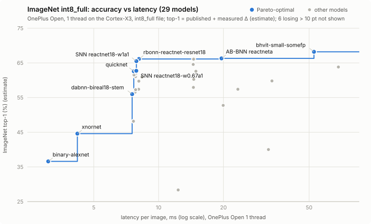

<p align="center"></p>

<h1 align="center">Bitino</h1>

<p align="center"><b>1-bit neural networks that keep your phone cool.</b><br>
A fast, dependency-free runtime for binary neural networks on phone and laptop CPUs, with a zoo of 132 published
BNNs converted from their original checkpoints.</p>

<p align="center">
  <a href="https://github.com/fedeloper/bitino/actions/workflows/ci.yml"></a>
  <a href="https://github.com/fedeloper/bitino/releases"></a>
  <a href="LICENSE"></a>
  
  
  <a href="https://colab.research.google.com/github/fedeloper/bitino/blob/main/examples/colab/bitino_quickstart.ipynb"></a>
</p>

<p align="center">
  <a href="https://federicofontana.dev/bitino/">Website</a> ·
  <a href="docs/MODEL_ZOO.md">Model zoo</a> ·
  <a href="docs/SPEED.md">Benchmarks</a> ·
  <a href="docs/getting-started.md">Getting started</a> ·
  <a href="docs/python.md">Python API</a> ·
  <a href="docs/android-deployment.md">Android</a>
</p>

---

Bitino runs **binary neural networks** (BNNs: 1-bit weights and activations) on the CPU of an Android phone or a
laptop. It is a C++17 runtime with no dependencies, with hand-written NEON kernels (ARMv8 dotprod / i8mm, ARMv7) and
AVX2 / AVX-VNNI kernels. It comes with converters that read networks from their authors' **original** checkpoints
(Larq, PyTorch, OpenVINO, ONNX, Brevitas, MindSpore, …), a full-integer int8 path, and a curated zoo of every BNN with
public weights we could find.

<!-- generated:stats -->
**343** binary networks investigated, **223** with verified public weights, **132** converted and validated against their original framework, **11** redistributable as converted files (explicit permissive weights licence). Fetch recipes: 131 verified end to end, 1 broken upstream.
<!-- /generated:stats -->

<p align="center"></p>
<p align="center"><sub>ImageNet BNNs on one core of a OnePlus Open (Snapdragon 8 Gen 2), batch 1: accuracy against measured
latency. Every point is a published network converted from its original checkpoint.</sub></p>

## Highlights

- **Fast on one core.**
  - QuickNet-Small at 4.7 ms, QuickNet at 7.4 ms and ReActNet-18 at 10.8 ms per ImageNet image on a single phone
    core.
  - Faster than Larq Compute Engine on every model on every core measured: **1.35×** on a Cortex-X3, 1.14× on a
    Cortex-A715, 1.24× on a Cortex-A510, 1.12× on a Cortex-A75, 1.11× on a 32-bit Cortex-A53; and **1.6–2.05×**
    faster than daBNN on its own models.
- **Real networks, verified.** 132 published BNNs from ten frameworks. Each conversion is checked against a float64
  evaluation of the source model (the source framework itself wherever it has a float64 mode). The exact `neon` stage is bit-identical with the reference executor.
- **Full-integer path.** `int8_full` runs the whole network in integers (binary convs, int8 everything else). That is
  about 0.85× the float latency on the measured phones; the accuracy change of each file is in the zoo tables.
- **Honest numbers.** Every timing comes from real hardware: four Android phones and an x86-64 host, with date, thread
  setting and clock state recorded. Emulators are used for correctness only, never for speed.
- **Runs everywhere a CPU does.**
  - Android arm64 and 32-bit armeabi-v7a, Linux aarch64 / x86-64, Python on Linux, macOS and Windows.
  - An Android library (AAR) with a Kotlin API and two example apps.

*Un bitino* is Italian for "a little bit", which is all a binary network needs per weight.

## Quickstart

```bash
pip install "bitino[image] @ git+https://github.com/fedeloper/bitino"   # builds the native runtime (CMake + a C++17 compiler)
```

```python
import bitino

m = bitino.load("ab-bnn-imagenet-reactnet18")   # MIT-licensed weights, downloaded from the release (SHA-256 checked)
logits = m.predict_image("cat.jpg")             # the model's own preprocessing, then the runtime
print(logits.argmax(), m.benchmark(threads=1), "ms on this CPU")
```

Or try it in the browser: [](https://colab.research.google.com/github/fedeloper/bitino/blob/main/examples/colab/bitino_quickstart.ipynb)
(Colab runs on a cloud x86 server, not a phone; the phone numbers are below). Prebuilt wheels for Linux x86-64 /
aarch64, macOS arm64 and Windows x64 will be published on PyPI; until then pip builds the runtime from this repository.

The same from a terminal:

```bash
bitino list --converted --task imagenet                     # browse the zoo
bitino run ab-bnn-imagenet-reactnet18 --image cat.jpg --bench
bitino fetch larq-zoo-quicknet                              # any other model: the authors' weights, converted locally
```

Models whose weights licence is not explicitly permissive are not redistributed. `bitino fetch` downloads them from
where the authors published them and converts them on your machine; they then load the same way.

<details>
<summary><b>Build from source</b></summary>

```bash
git clone https://github.com/fedeloper/bitino && cd bitino
pip install -e .                                           # the bitino CLI and Python API
cmake -S . -B build/host -G Ninja -DCMAKE_BUILD_TYPE=Release && cmake --build build/host

bitino fetch ab-bnn-imagenet-reactnet18 --prebuilt         # converted file from the release (permissive licence)
bitino fetch ab-bnn-imagenet-reactnet18                    # or: original weights + code, SHA-256 check, local conversion
bitino bench ab-bnn-imagenet-reactnet18 --threads 4
bitino validate ab-bnn-imagenet-reactnet18                 # runtime vs numpy executor vs source framework
```

How `fetch` works:
- It downloads the weights from where the authors published them, into a fresh directory, and checks their SHA-256.
- It downloads the authors' model code, pinned to the recorded commit.
- It runs the converter with `python -I`; checkpoints are read with `torch.load(weights_only=True)` only.
- The converted data section is compared with the published conversion: `IDENTICAL` means bit-identical weights and
  constants.

Converters run in the source framework's environment (`envs/`). Without a dataset, `fetch` generates a small synthetic
eval set: enough for conversion and runtime checks, not for accuracy numbers.
</details>

<details>
<summary><b>Run on an Android phone from the command line</b> (arm64, no root)</summary>

Take `bitino_bench-android-arm64` from the [Releases](https://github.com/fedeloper/bitino/releases) page (or build
it with `scripts/build_android.sh` and the NDK):

```bash
adb push bitino_bench-android-arm64 /data/local/tmp/bitino_bench
adb push ~/.cache/bitino/models/ab-bnn-imagenet-reactnet18/model.bitino /data/local/tmp/
adb shell /data/local/tmp/bitino_bench --model /data/local/tmp/model.bitino --threads 1 --stage all
```
</details>

## Android apps

The Android library (`android/bitino`) is an AAR for arm64-v8a and armeabi-v7a, API 24+. It wraps the runtime in a
small Kotlin API, and its preprocessing reproduces each model's Python pipeline bit for bit, Pillow resampling
included.

```kotlin
// build.gradle.kts: implementation("io.github.fedeloper:bitino-android:0.1.0")
// (until it is on Maven Central: android/gradlew -p android :bitino:publishToMavenLocal, and add mavenLocal())
import io.github.fedeloper.bitino.Bitino

val model = Bitino.load(context, "ab-bnn-imagenet-reactnet18.bitino", threads = 1)   // asset or file path
val scores = model.run(bitmap)              // resize / crop / normalize exactly as the model's manifest says
val top5 = Bitino.topK(Bitino.softmax(scores), 5)
model.close()
```

| App | What it does |
|---|---|
| [`android/demo`](android/demo) | Classifies the camera feed live with ReActNet-18 (bundled, MIT weights). Shows latency and fps. |
| [`android/deepfake`](android/deepfake) | Finds the images on screen with classical layout analysis and runs a binary deepfake detector ([Faster Than Lies](https://arxiv.org/abs/2406.04932)) on each, flagging the fake ones in place. With an ImageNet model instead, it labels each image with its class. Detectors are not bundled (no redistribution licence yet). |

Native code can link `libbitino.a` and use the C API (`runtime/include/bitino/bitino_c.h`). Details:
[docs/android-deployment.md](docs/android-deployment.md).

## Benchmarks

All numbers: median latency of one inference, batch 1, measured on the phone, pinned to its fastest core.

**Against Larq Compute Engine and TensorFlow Lite.** Same Larq Zoo weights, 1 thread, batch 1, every runtime pinned to
the same core by one launcher.

| Phone (core) | Bitino vs LCE 0.16 |
|---|---|
| OnePlus Open (Cortex-X3) | **1.35× faster** (all 11 models, 1.14–1.74×) |
| OnePlus Open (Cortex-A715) | **1.14× faster** (all 11, 1.05–1.29×) |
| OnePlus Open (Cortex-A510) | **1.24× faster** (all 11, 1.12–1.35×) |
| moto e13 (Cortex-A75) | **1.12× faster** (all 11, 1.03–1.25×) |
| Redmi 9A (Cortex-A53, 32-bit) | **1.11× faster** (5 models, earlier runtime) |

TFLite fp32 is 5–13× slower than Bitino. TFLite int8 is 1.4–4.8× slower, and its top-1 class agrees with the float
model on only 45–66 % of the images.

Tables, method, setup differences and raw data: [docs/comparison-lce-tflite.md](docs/comparison-lce-tflite.md).

**Against daBNN.** On daBNN's own Bi-Real Net-18 models (same weights and input, 1 thread, pinned to the same core),
Bitino is 1.60–2.05× faster on five arm64 cores (Cortex-X3, A715, A510, A75; geometric mean 1.81×) and 6.5–7.5×
faster on a 32-bit Cortex-A53, with less peak memory. Method and data: [docs/comparison-dabnn.md](docs/comparison-dabnn.md).

<details>
<summary><b>Latency of every converted model on every phone</b></summary>

<!-- generated:speed -->
Median latency of one inference (batch 1) in ms. Main columns: **OnePlus Open (CPH2551)** (Qualcomm Snapdragon 8 Gen 2 (SM8550)); 1 thread = pinned to the fastest core; int8 = the full-integer file (int8_full) where measured, else the int8 kernels on the exact file. Accuracy: the original model in its own framework → Bitino's exact stage, on the small check subset; int8_full Δ: the full-integer file's paired difference against the exact stage. Fastest first.

### CIFAR-10 (23 models)


| model | accuracy (reference → Bitino) | int8_full Δ | OnePlus Open 1 thread | OnePlus Open 4 threads | OnePlus Open int8 1 thread | Galaxy S22 1 thread | moto e13 1 thread | Redmi 9A 1 thread (32-bit) |
|---|---|---:|---:|---:|---:|---:|---:|---:|
| `brevitas-bnn-pynq-cnv-1w1a` | 85.9% → 85.9% | -0.77 pt | 0.282 ◇ | 0.215 ◇ | 0.431 ◇ | – | 1.32 | 3.15 |
| `finn-examples-bnn-pynq-cnv-w1a1` | 85.9% → 85.9% | -0.77 pt | 0.282 ◇ | 0.213 ◇ | 0.251 ◇ | – | 1.33 | – |
| `aliasgharshinwari-finn-cnv-w1a1-cifar10` | 89.8% → 89.8% | +0.06 pt | 0.286 ◇ | 0.217 ◇ | 0.281 ◇ | 0.57 ⚠ | 1.32 | – |
| `bnn-pynq-cnv-w1a1-cifar10` | 86.7% → 86.7% | +0.42 pt | 0.3 ◇ | 0.222 ◇ | 0.398 ◇ | – | 1.36 | – |
| `shuaiz-bireal20-cifar10` | 84.4% → 84.4% | – | 0.41 ◇ | 0.474 ◇ | 0.53 ◇ | – | 1.66 | – |
| `fda-bnn-resnet20-cifar10-mindspore` | 89.8% → 89.8% | – | 0.45 ◇ | 0.492 ◇ | 0.442 ◇ | – | 1.86 | – |
| `biper-resnet20-cifar10` | 86.7% → 86.7% | – | 0.454 ◇ | 0.398 ◇ | 0.413 ◇ | – | 1.88 | – |
| `recu-resnet20-cifar10` | 88.3% → 88.3% | – | 0.467 ◇ | 0.544 ◇ | 0.53 ◇ | – | 1.87 | – |
| `rbnn-resnet20-cifar10` | 88.3% → 88.3% | – | 0.495 ◇ | 0.598 ◇ | 0.427 ◇ | – | 2.03 | 7.2 |
| `siman-resnet20-cifar10` | 87.5% → 87.5% | -2.32 pt | 0.501 ◇ | 0.509 ◇ | 0.56 ◇ | – | 2.03 | – |
| `rbnn-resnet20-bireal-cifar10` | 89.8% → 89.8% | – | 0.508 ◇ | 0.515 ◇ | 0.42 ◇ | – | 2.06 | – |
| `adabin-resnet20-cifar10` | 91.4% → 91.4% | -0.64 pt | 0.879 ◇ | 0.753 ◇ | 0.898 ◇ | 1.22 ⚠ | 4.04 | – |
| `ab-bnn-cifar10-reactneta` | 91.4% → 91.4% | – | 1.53 ◇ | 0.924 ◇ | 1.49 ◇ | 2.6 ⚠ | 7.97 | – |
| `biper-resnet18-cifar10` | 94.5% → 94.5% | – | 1.97 ◇ | 1.08 ◇ | 1.96 ◇ | – | 9.71 | – |
| `recu-resnet18-cifar10` | 93.8% → 93.8% | – | 2 ◇ | 1.12 ◇ | 1.97 ◇ | – | 9.82 | – |
| `biper-vgg-small-cifar10` | 96.1% → 96.1% | -1.40 pt | 2.04 ◇ | 1.06 ◇ | 1.96 ◇ | – | 10.2 | – |
| `recu-vgg-small-cifar10` | 96.1% → 96.1% | -0.84 pt | 2.04 ◇ | 1.04 ◇ | 1.96 ◇ | – | 10.2 | – |
| `rbnn-vgg-small-cifar10` | 91.4% → 91.4% | -0.50 pt | 2.12 ◇ | 1.13 ◇ | 2.05 ◇ | – | 10.9 | – |
| `siman-vgg-small-cifar10` | 95.3% → 95.3% | – | 2.13 ◇ | 1.12 ◇ | 2.05 ◇ | – | 10.9 | – |
| `rbnn-resnet18-cifar10` | 94.5% → 94.5% | – | 2.16 ◇ | 1.32 ◇ | 2.08 ◇ | – | 10.8 | – |
| `siman-resnet18-cifar10` | 95.3% → 95.3% | – | 2.17 ◇ | 1.31 ◇ | 2.07 ◇ | – | 10.7 | – |
| `ab-bnn-cifar10-reactnet18` | 93.8% → 93.8% | +0.06 pt | 2.25 ◇ | 1.23 ◇ | 2.08 ◇ | 3.72 ⚠ | 11.3 | 25.9 |
| `bnas-a-cifar10` | 93.8% → 93.8% | -0.42 pt | 8.69 ◇ | 5.22 ◇ | 7.19 ◇ | – | 49.9 | – |

### ImageNet (55 models)




| model | accuracy (reference → Bitino) | int8_full Δ | OnePlus Open 1 thread | OnePlus Open 4 threads | OnePlus Open int8 1 thread | Galaxy S22 1 thread | moto e13 1 thread | Redmi 9A 1 thread (32-bit) |
|---|---|---:|---:|---:|---:|---:|---:|---:|
| `larq-zoo-quicknet-small` | 59.4% → 58.6% | – | 4.67 ◇ | 2.49 ◇ | 4.7 ◇ | 9.26 † | 23.4 | 55.0 |
| `larq-zoo-binary-alexnet` | 28.9% → 28.9% | +0.30 pt | 5.45 ◇ | 2.69 ◇ | 3.07 ◇ | – | 29.3 | – |
| `larq-zoo-quicknet` | 66.4% → 66.4% | -0.72 pt | 7.36 ◇ | 3.9 ◇ | 7.67 ◇ | – | 38.6 | 92.7 |
| `larq-zoo-xnornet` | 34.4% → 34.4% | -0.36 pt | 7.77 ◇ | 4.16 ◇ | 4.2 ◇ | – | 42.0 | – |
| `dabnn-bireal18-stem` | 58.6% → 58.6% | -0.42 pt | 7.96 ◇ | 4.25 ◇ | 6.71 ◇ | – | 45.2 | – |
| `larq-zoo-birealnet` | 57.8% → – | -0.20 pt | 10.3 ◇ | 5.41 ◇ | 7.08 ◇ | – | 59.1 | 125.3 |
| `dabnn-bireal18` | 58.6% → 58.6% | +0.16 pt | 10.3 ◇ | 5.39 ◇ | 8.5 ◇ | – | 59.8 | – |
| `bitorch-resnete18-imagenet` | 64.8% → 62.5% | -0.84 pt | 10.4 ◇ | 5.46 ◇ | 8.1 ◇ | – | 60.0 | – |
| `larq-zoo-binary-resnet-e18` | 55.5% → 55.5% | -0.92 pt | 10.4 ◇ | 5.44 ◇ | 7.36 ◇ | – | 59.7 | – |
| `nncf-resnet18-binarization-xnor` | 61.7% → 61.7% | -0.12 pt | 10.7 ◇ | 5.54 ◇ | 7.83 ◇ | – | 59.8 | – |
| `nncf-resnet18-binarization-dorefa` | 62.5% → 62.5% | +0.14 pt | 10.7 ◇ | 5.53 ◇ | 7.81 ◇ | – | 59.7 | – |
| `omz-resnet18-xnor-binary-onnx-0001` | 59.4% → 59.4% | – | 10.7 ◇ | 5.59 ◇ | 7.59 ◇ | – | 59.9 | 123.4 |
| `omz-resnet18-xnor-binary-onnx-0001-fp16` | 64.1% → 64.1% | +0.00 pt | 10.8 ◇ | 5.54 ◇ | 7.57 ◇ | – | 60.1 | – |
| `snn-subbit-reactnet18-w1a1-imagenet` | 64.8% → 64.8% | -0.20 pt | 10.8 ◇ | 5.55 ◇ | 7.83 ◇ | – | 61.1 | – |
| `rbonn-reactnet-resnet18-imagenet` | 65.6% → 65.6% | -0.56 pt | 10.8 ◇ | 5.53 ◇ | 7.83 ◇ | – | 61.0 | – |
| `ab-bnn-imagenet-reactnet18` | 65.6% → 64.8% | -0.34 pt | 10.8 ◇ | 5.53 ◇ | 7.7 ◇ | 16.9 ⚠ | 61.2 | 132.3 |
| `snn-subbit-reactnet18-w0.67a1-imagenet` | 64.1% → 64.8% | -0.68 pt | 10.8 ◇ | 5.52 ◇ | 7.83 ◇ | – | 61.0 | – |
| `biper-resnet18-imagenet` | 59.4% → 59.4% | – | 11.0 ◇ | 5.75 ◇ | 7.54 ◇ | – | 61.0 | – |
| `recu-resnet18-imagenet` | 59.4% → 59.4% | – | 11.0 ◇ | 5.74 ◇ | 7.53 ◇ | – | 60.9 | 132.7 |
| `siman-resnet18-imagenet` | 54.7% → 54.7% | – | 11.1 ◇ | 6.05 ◇ | 7.5 ◇ | – | 62.4 | – |
| `tensorpack-dorefa-alexnet-w1a1-g32` | 46.1% → 46.1% | -0.32 pt | 11.3 ◇ | 5.81 ◇ | 7.64 ◇ | – | 59.9 | – |
| `rbnn-resnet18-imagenet` | 53.1% → 53.1% | -0.90 pt | 11.4 ◇ | 6.25 ◇ | 8.31 ◇ | – | 63.3 | – |
| `sa-bnn-resnet18-imagenet` | 61.7% → 62.5% | -0.78 pt | 11.5 ◇ | 5.79 ◇ | 8.26 ◇ | – | 61.4 | – |
| `larq-zoo-real-to-binary-net` | 64.8% → 64.8% | – | 12.1 ◇ | 6.44 ◇ | 9.16 ◇ | – | 65.5 | – |
| `larq-zoo-quicknet-xl-legacy` | 64.1% → 64.8% | -0.92 pt | 13.0 ◇ | 7.39 ◇ | 13.2 ◇ | – | 67.6 | – |
| `larq-zoo-quicknet-large` | 71.1% → 70.3% | – | 13.2 ◇ | 7.2 ◇ | 13.1 ◇ | – | 66.8 | 157.6 |
| `bi-vit-deit-tiny` | 15.6% → 15.6% | -0.34 pt | 13.7 ◇ | 8.06 ◇ | 12.3 ◇ | 42.1 ⚠ | 67.4 | – |
| `biper-resnet34-imagenet` | 66.4% → 66.4% | – | 17.3 ◇ | 9.11 ◇ | 13.6 ◇ | – | 89.7 | – |
| `recu-resnet34-imagenet` | 68.8% → 68.8% | – | 17.4 ◇ | 9.12 ◇ | 13.6 ◇ | – | 89.6 | – |
| `ab-bnn-imagenet-reactnet34` | 67.2% → 68.0% | -0.62 pt | 17.4 ◇ | 8.92 ◇ | 14.6 ◇ | 27.0 ⚠ | 90.0 | – |
| `siman-resnet34-imagenet` | 59.4% → 60.9% | -14.10 pt | 17.8 ◇ | 9.82 ◇ | 14.7 ◇ | – | 93.5 | – |
| `rbnn-resnet34-imagenet` | 64.1% → 63.3% | -0.52 pt | 18.1 ◇ | 10.0 ◇ | 13.4 ◇ | – | 93.8 | – |
| `ab-bnn-imagenet-reactneta` | 66.4% → 65.6% | -0.58 pt | 19.8 ◇ | 10.0 ◇ | 19.5 ◇ | 19.6 ⚠ | 95.9 | – |
| `larq-zoo-binary-densenet28` | 60.9% → 60.9% | -0.66 pt | 21.3 ◇ | 11.1 ◇ | 14.6 ◇ | – | 113.3 | – |
| `bitorch-densenet28-imagenet` | 59.4% → 59.4% | -0.76 pt | 22.6 ◇ | 11.8 ◇ | 14.5 ◇ | – | 119.4 | – |
| `larq-zoo-dorefanet` | 46.1% → 46.1% | -0.64 pt | 23.2 ◇ | 12.0 ◇ | 19.9 ◇ | – | 117.9 | – |
| `bnext-tiny` | 69.5% → 68.0% | – | 24.1 ◇ | 12.4 ◇ | 22.0 ◇ | – | 116.5 | 343.2 |
| `larq-zoo-binary-densenet37` | 66.4% → 65.6% | -41.28 pt | 24.4 ◇ | 12.9 ◇ | 19.8 ◇ | – | 129.4 | – |
| `larq-zoo-meliusnet22` | 65.6% → 66.4% | -57.38 pt | 24.9 ◇ | 13.0 ◇ | 23.0 ◇ | – | 127.3 | – |
| `bnas-d-imagenet` | 60.2% → 60.2% | -54.94 pt | 26.2 ◇ | 14.4 ◇ | 16.0 ◇ | – | 137.0 | – |
| `bitorch-meliusnet22-imagenet` | 66.4% → 65.6% | -61.52 pt | 26.5 ◇ | 13.9 ◇ | 19.6 ◇ | – | 136.5 | – |
| `bhvit-tiny-binary` | 64.1% → 62.5% | – | 28.7 ◇ | 14.4 ◇ | 29.0 ◇ | 46.6 ⚠ | 140.8 | 576.8 |
| `bhvit-tiny-somefp` | 65.6% → 65.6% | -6.20 pt | 31.0 ◇ | 15.6 ◇ | 33.6 ◇ | 58.8 ⚠ | 154.2 | – |
| `bnas-e-imagenet` | 56.2% → 56.2% | -0.92 pt | 32.9 ◇ | 18.3 ◇ | 23.3 ◇ | – | 182.9 | – |
| `larq-zoo-binary-densenet45` | 60.9% → 61.7% | -43.86 pt | 33.0 ◇ | 17.2 ◇ | 27.0 ◇ | – | 171.8 | – |
| `omz-resnet50-binary-0001-fp16` | 71.9% → 73.4% | – | 34.0 ◇ | 17.3 ◇ | 19.9 ◇ | – | 180.9 | – |
| `omz-resnet50-binary-0001` | 72.7% → 73.4% | – | 34.1 ◇ | 17.3 ◇ | 19.9 ◇ | – | 180.7 | – |
| `bi-vit-deit-small` | 11.7% → 10.9% | -0.88 pt | 35.2 ◇ | 19.6 ◇ | 32.4 ◇ | 113.1 ⚠ | 168.8 | – |
| `bhvit-small-binary` | 68.8% → 65.6% | – | 44.0 ◇ | 22.2 ◇ | 53.3 ◇ | 85.8 ⚠ | 216.0 | – |
| `larq-zoo-binary-densenet37-dilated` | 65.6% → 65.6% | -59.00 pt | 44.3 ◇ | 22.7 ◇ | 33.7 ◇ | – | 239.0 | – |
| `bhvit-small-somefp` | 72.7% → 76.6% | -1.90 pt | 46.6 ◇ | 23.3 ◇ | 52.7 ◇ | 106.9 ⚠ | 230.1 | – |
| `bnext-small` | 76.6% → 75.0% | – | 47.0 ◇ | 23.3 ◇ | 43.7 ◇ | – | 223.1 | 638.6 |
| `bnext-middle` | 78.9% → 78.9% | – | 80.4 ◇ | 40.2 ◇ | 77.5 ◇ | – | 388.3 | – |
| `bnas-h-imagenet` | 60.2% → 60.2% | +0.08 pt | 106.1 ◇ | 53.3 ◇ | 68.4 ◇ | – | 561.2 | – |
| `bnext-large` | 79.7% → 80.5% | – | 183.2 ◇ | 90.2 ◇ | 177.4 ◇ | – | 884.1 | – |

### Other tasks (54 models)

| model | task | accuracy (reference → Bitino) | int8_full Δ | OnePlus Open 1 thread | OnePlus Open 4 threads | OnePlus Open int8 1 thread | Galaxy S22 1 thread | moto e13 1 thread | Redmi 9A 1 thread (32-bit) |
|---|---|---|---:|---:|---:|---:|---:|---:|---:|
| `brevitas-bnn-pynq-tfc-1w1a` | mnist | 96.9% → 96.9% | – | 0.002 ◇ | 0.013 ◇ | 0.006 ◇ | – | 0.004 | – |
| `brevitas-bnn-pynq-sfc-1w1a` | mnist | 100.0% → 100.0% | – | 0.003 ◇ | 0.025 ◇ | 0.003 ◇ | – | 0.013 | – |
| `finn-examples-bnn-pynq-tfc-w1a1` | mnist | 96.9% → 96.9% | – | 0.003 ◇ | 0.012 ◇ | 0.003 ◇ | – | 0.004 | – |
| `bnn-pynq-lfc-w1a1-mnist` | mnist | 100.0% → 100.0% | – | 0.017 ◇ | 0.053 ◇ | 0.018 ◇ | – | 0.076 | – |
| `brevitas-bnn-pynq-lfc-1w1a` | mnist | 100.0% → 100.0% | – | 0.018 ◇ | 0.052 ◇ | 0.018 ◇ | – | 0.075 | – |
| `finn-examples-cnv-w1a1-gtsrb` | gtsrb | 93.8% → 93.8% | – | 0.284 ◇ | 0.209 ◇ | 0.253 ◇ | – | 1.32 | – |
| `bnn-pynq-cnv-w1a1-gtsrb` | gtsrb | 93.8% → 93.8% | – | 0.328 ◇ | 0.209 ◇ | 0.269 ◇ | – | 1.34 | – |
| `brillsson-quicknet` | non-semantic speech representation | 90.7% → 90.7% | – | 0.971 ◇ | 0.679 ◇ | 0.883 ◇ | – | 5.02 | – |
| `ab-bnn-cifar100-reactneta` | cifar100 | 71.9% → 71.9% | -0.31 pt | 1.54 ◇ | 0.929 ◇ | 1.54 ◇ | 2.63 ⚠ | 8.02 | – |
| `larqface-quicknet-msceleb` | face-recognition | 99.0% → 99.0% | – | 1.8 ◇ | 1.15 ◇ | 1.68 ◇ | – | 9.02 | – |
| `ab-bnn-cifar100-reactnet18` | cifar100 | 69.5% → 69.5% | – | 2.28 ◇ | 1.23 ◇ | 2.11 ◇ | 3.72 ⚠ | 11.4 | – |
| `brillsson-binarydensenet28` | non-semantic speech representation | 90.5% → 90.5% | – | 2.34 ◇ | 1.55 ◇ | 1.96 ◇ | – | 12.8 | – |
| `brillsson-meliusnet22` | non-semantic speech representation | 91.9% → 91.9% | – | 3.19 ◇ | 2.15 ◇ | 2.9 ◇ | – | 17.5 | – |
| `larqface-binarydensenet28-msceleb` | face-recognition | 99.2% → 99.2% | – | 5.2 ◇ | 3.1 ◇ | 3.99 ◇ | – | 29.0 | – |
| `larqface-binarydensenet37-msceleb` | face-recognition | 99.2% → 99.2% | – | 6.07 ◇ | 3.63 ◇ | 4.79 ◇ | – | 33.0 | – |
| `larqface-binaryfacenet-msceleb` | face-recognition | 95.1% → 95.1% | – | 6.2 ◇ | 3.87 ◇ | 6.2 ◇ | – | 27.4 | 100.7 |
| `larqface-binarydensenet45-msceleb` | face-recognition | 99.2% → 99.2% | – | 8.39 ◇ | 4.92 ◇ | 6.52 ◇ | – | 44.3 | – |
| `bimatting-bimobilenet-backbone` | imagenet | 55.5% → 55.5% | -22.86 pt | 8.52 ◇ | 4.8 ◇ | 8.36 ◇ | – | 42.0 | – |
| `ida-det-bires18-imagenet-backbone` | imagenet | 65.6% → 65.6% | -0.64 pt | 10.8 ◇ | 5.55 ◇ | 7.83 ◇ | – | 61.1 | – |
| `bbcu-sr-m-x4` | single-image-super-resolution-x4 | 27.22 dB → 27.22 dB | – | 14.5 ◇ | 7.1 ◇ | 16.0 ◇ | 24.4 ⚠ | 75.3 | – |
| `bbcu-sr-m-x2` | single-image-super-resolution-x2 | 31.89 dB → 31.89 dB | – | 16.4 ◇ | 8.85 ◇ | 16.9 ◇ | 25.6 ⚠ | 85.5 | – |
| `s2bnn-reacta-distill-only` | imagenet self-supervised representation learning | – → 0.96370 | – | 20.0 ◇ | 10.2 ◇ | 19.9 ◇ | – | 96.0 | – |
| `burn-reacta-stage2` | imagenet self-supervised representation learning | – → 0.99615 | – | 20.3 ◇ | 10.5 ◇ | 20.0 ◇ | – | 97.4 | – |
| `ftl-deepfake-bnext-t-cocofake` | deepfake-image-detection | – → – | – | 25.5 ◇ | 13.2 ◇ | 26.3 ◇ | – | 126.5 | – |
| `ftl-deepfake-bnext-t-cocofake-unfrozen` | deepfake-image-detection | – → – | – | 25.6 ◇ | 13.3 ◇ | 26.1 ◇ | – | 126.8 | 384.4 |
| `ftl-deepfake-bnext-t-dffd` | deepfake-image-detection | – → – | – | 25.7 ◇ | 13.3 ◇ | 26.6 ◇ | – | 126.0 | – |
| `ftl-deepfake-bnext-t-cifake-unfrozen` | deepfake-image-detection | – → – | – | 25.7 ◇ | 13.3 ◇ | 26.3 ◇ | – | 126.7 | – |
| `ftl-deepfake-bnext-t-dffd-unfrozen` | deepfake-image-detection | – → – | – | 25.7 ◇ | 13.3 ◇ | 26.3 ◇ | – | 126.3 | – |
| `ftl-deepfake-bnext-t-cifake` | deepfake-image-detection | – → – | – | 25.8 ◇ | 13.3 ◇ | 26.2 ◇ | – | 125.9 | – |
| `bsrc2023-binary-sr-x2-v0` | single-image-super-resolution-x2 | 31.88 dB → 31.88 dB | – | 25.9 ◇ | 13.8 ◇ | 15.8 ◇ | – | 144.5 | – |
| `bibert-bert-base-sst2` | glue-sst2 | 89.8% → 89.8% | -0.34 pt | 27.2 ◇ | 13.7 ◇ | 27.9 ◇ | – | 135.9 | 322.3 |
| `bbcu-deblocking` | jpeg-artifact-reduction | 31.33 dB → 31.33 dB | – | 27.4 ◇ | 13.3 ◇ | 28.2 ◇ | 33.1 ⚠ | 143.5 | – |
| `bbcu-denoise` | color-image-denoising | 29.74 dB → 29.74 dB | – | 27.9 ◇ | 13.6 ◇ | 28.2 ◇ | 34.0 ⚠ | 147.2 | – |
| `bbcu-sr-l-x2` | single-image-super-resolution-x2 | 32.03 dB → 32.03 dB | – | 35.4 ◇ | 18.0 ◇ | 19.5 ◇ | 36.6 ⚠ | 197.4 | – |
| `bsrc2023-binary-sr-x4-v0` | single-image-super-resolution-x4 | 27.22 dB → 27.22 dB | – | 38.7 ◇ | 17.6 ◇ | 25.9 ◇ | – | 224.2 | – |
| `bsrc2023-binary-sr-x4-v1` | single-image-super-resolution-x4 | 27.32 dB → 27.32 dB | – | 43.8 ◇ | 20.3 ◇ | 29.7 ◇ | – | 249.8 | – |
| `bibert-bert-base-mrpc` | glue-mrpc | 76.6% → 76.6% | +0.98 pt | 45.2 ◇ | 21.4 ◇ | 49.4 ◇ | 148.9 ⚠ | 227.4 | – |
| `ftl-deepfake-bnext-s-dffd` | deepfake-image-detection | – → – | – | 48.0 ◇ | 24.0 ◇ | 48.7 ◇ | – | 232.0 | – |
| `ftl-deepfake-bnext-s-cifake-unfrozen` | deepfake-image-detection | – → – | – | 48.0 ◇ | 24.1 ◇ | 48.4 ◇ | – | 232.4 | – |
| `ftl-deepfake-bnext-s-cifake` | deepfake-image-detection | – → – | – | 48.1 ◇ | 24.1 ◇ | 48.0 ◇ | – | 231.4 | – |
| `ftl-deepfake-bnext-s-cocofake` | deepfake-image-detection | – → – | – | 48.1 ◇ | 24.1 ◇ | 48.5 ◇ | – | 232.2 | – |
| `ftl-deepfake-bnext-s-dffd-unfrozen` | deepfake-image-detection | – → – | – | 48.2 ◇ | 24.1 ◇ | 48.5 ◇ | – | 231.6 | – |
| `ftl-deepfake-bnext-s-cocofake-unfrozen` | deepfake-image-detection | – → – | – | 48.3 ◇ | 24.1 ◇ | 48.2 ◇ | – | 232.7 | – |
| `bibert-bert-base-mnli` | glue-mnli | 61.7% → 61.7% | +0.54 pt | 52.4 ◇ | 24.7 ◇ | 54.9 ◇ | 124.7 ⚠ | 258.4 | – |
| `bbcu-sr-l-x4` | single-image-super-resolution-x4 | 27.36 dB → 27.36 dB | – | 52.7 ◇ | 24.6 ◇ | 19.6 ◇ | 53.5 ⚠ | 297.4 | – |
| `bibert-bert-base-qqp` | glue-qqp | 83.6% → 83.6% | -0.59 pt | 58.0 ◇ | 27.2 ◇ | 60.2 ◇ | 160.7 ⚠ | 286.9 | – |
| `gsb-deit-s-cifar100-stage2` | cifar100 | 70.3% → 69.5% | -1.99 pt | 75.4 ◇ | 38.2 ◇ | 64.2 ◇ | – | 417.0 | – |
| `ftl-deepfake-bnext-m-dffd` | deepfake-image-detection | – → – | – | 81.8 ◇ | 41.0 ◇ | 82.0 ◇ | – | 399.3 | – |
| `ftl-deepfake-bnext-m-cifake-unfrozen` | deepfake-image-detection | – → – | – | 82.1 ◇ | 41.2 ◇ | 82.1 ◇ | – | 397.8 | – |
| `ftl-deepfake-bnext-m-cifake` | deepfake-image-detection | – → – | – | 82.1 ◇ | 41.2 ◇ | 82.0 ◇ | – | 396.7 | – |
| `ftl-deepfake-bnext-m-cocofake-unfrozen` | deepfake-image-detection | – → – | – | 82.3 ◇ | 41.1 ◇ | 82.1 ◇ | – | 397.7 | – |
| `ftl-deepfake-bnext-m-cocofake` | deepfake-image-detection | – → – | – | 82.3 ◇ | 41.1 ◇ | 82.1 ◇ | – | 397.1 | – |
| `ftl-deepfake-bnext-m-dffd-unfrozen` | deepfake-image-detection | – → – | – | 82.6 ◇ | 41.1 ◇ | 82.0 ◇ | – | 398.4 | – |
| `bsrc2023-binary-sr-x2-v1` | single-image-super-resolution-x2 | 32.22 dB → 32.22 dB | – | 91.6 ◇ | 45.0 ◇ | 61.5 ◇ | – | 544.4 | – |

Unmarked = clean (every repeat at full clocks). ◇ = the phone's own power policy held the clock ceiling below the maximum with no thermal event (stock settings, screen off; the ceiling is recorded per run); ⚠ = at least one repeat ran under a thermal CPU-frequency cap (e.g. a phone charging over USB); † = run made before the frequency-cap check existed (caps unknown). Runs per device and validity: Galaxy S22: 185 thermal-throttled, 24 unknown-caps; OnePlus Open: 2406 vendor-policy; moto e13: 876 clean; Redmi 9A: 107 clean. 

Every phone with 1 and 4 threads and int8: [docs/SPEED.md](docs/SPEED.md). On-device correctness: Galaxy S22: 381/381 correctness checks passed on 114 models, 2026-11-02 to 2026-11-12 (outputs byte-identical to a validated emulated-ARM or reference-phone run of the same code); OnePlus Open: 415/415 correctness checks passed on 132 models, 2026-11-14 (outputs byte-identical to a validated emulated-ARM or reference-phone run of the same code); moto e13: 503/503 correctness checks passed on 132 models, 2026-11-14 (outputs byte-identical to a validated emulated-ARM or reference-phone run of the same code); Redmi 9A: 264/264 correctness checks passed on 132 models, 2026-11-14 (exact stage bit-identical to the numpy executor, float stage within tolerance of the float64 reference).
<!-- /generated:speed -->

The phones: `results/devices.json`. All runs with their clock state: `results/speed_<device>.json`; x86-64 host runs
(older runtime, labelled): `results/speed_x86.json`. Method: [docs/benchmarking.md](docs/benchmarking.md).
</details>

## Model zoo

Selected models (all converted models: [docs/MODEL_ZOO.md](docs/MODEL_ZOO.md); a searchable version is on the
[website](https://federicofontana.dev/bitino/)):

<!-- generated:zoo_top -->
| model | task | framework | accuracy (reference → Bitino) | eval set (n) | int8_full Δ vs exact | fastest phone ms (1 thread) | weights licence | release |
|---|---|---|---|---|---|---|---|---|
| `ab-bnn-cifar10-reactnet18` | cifar10-classification | pytorch | 93.8% → 93.8% | cifar10-test-first-128 (128) | +0.06 pt (cifar10-test-first-10000, n=10000) | 2.25 ◇ (OnePlus Open) | MIT (HF card) | yes |
| `ab-bnn-imagenet-reactnet18` | imagenet-classification | pytorch | 65.6% → 64.8% | imagenet-val-subset-128 (128) | -0.34 pt (imagenet-val-subset-5000, n=5000) | 10.8 ◇ (OnePlus Open) | MIT (HF model card metadata 'license: mit'); app | yes |
| `ab-bnn-imagenet-reactnet34` | imagenet-classification | pytorch | 67.2% → 68.0% | imagenet-val-subset-128 (128) | -0.62 pt (imagenet-val-subset-5000, n=5000) | 17.4 ◇ (OnePlus Open) | MIT (HF card) | yes |
| `ab-bnn-imagenet-reactneta` | imagenet-classification | pytorch | 66.4% → 65.6% | imagenet-val-subset-128 (128) | -0.58 pt (imagenet-val-subset-5000, n=5000) | 19.6 ⚠ (Galaxy S22) | MIT (HF card) | yes |
| `bbcu-sr-l-x4` | single-image-super-resolution-x4 | pytorch | 27.36 dB → 27.36 dB | set5-set14-b100-x4-lr32 (64) | – | 52.7 ◇ (OnePlus Open) | no explicit weights licence (inherits repo licen | – |
| `bhvit-tiny-binary` | imagenet-classification | pytorch | 64.1% → 62.5% | imagenet-val-subset-128 (128) | – | 28.7 ◇ (OnePlus Open) | no explicit weights licence (inherits repo MIT?  | – |
| `bi-vit-deit-tiny` | imagenet-classification | pytorch | 15.6% → 15.6% | imagenet-val-subset-128 (128) | -0.34 pt (imagenet-val-subset-5000_bhvit, n=5000) | 13.7 ◇ (OnePlus Open) | no explicit weights licence (inherits repo Apach | – |
| `bibert-bert-base-sst2` | glue-sst2 | pytorch | 89.8% → 89.8% | sst2-dev-128 (128) | -0.34 pt (sst2-dev-872, n=872) | 27.2 ◇ (OnePlus Open) | no explicit weights licence (inherits repo licen | – |
| `bnext-tiny` | imagenet-classification | pytorch | 69.5% → 68.0% | imagenet-val-subset-128 (128) | – | 24.1 ◇ (OnePlus Open) | no explicit weights licence (inherits repo Apach | – |
| `brevitas-bnn-pynq-cnv-1w1a` | cifar10-classification | pytorch+brevitas | 85.9% → 85.9% | cifar10-test-first-128 (128) | -0.77 pt (cifar10-test-first-10000, n=10000) | 0.282 ◇ (OnePlus Open) | no explicit weights licence (inherits repo licen | – |
| `larq-zoo-birealnet` | imagenet-classification | larq_zoo | 57.8% → – | imagenet-val-subset-128 (128) | -0.20 pt (imagenet-val-subset-5000, n=5000) | 10.3 ◇ (OnePlus Open) | No explicit weights licence (inherits repo licen | – |
| `larq-zoo-quicknet` | imagenet-classification | larq_zoo | 66.4% → 66.4% | imagenet-val-subset-128 (128) | -0.72 pt (imagenet-val-subset-5000, n=5000) | 7.36 ◇ (OnePlus Open) | No explicit weights licence (inherits repo licen | – |
| `larq-zoo-quicknet-large` | imagenet-classification | larq_zoo | 71.1% → 70.3% | imagenet-val-subset-128 (128) | – | 13.2 ◇ (OnePlus Open) | No explicit weights licence (inherits repo licen | – |
| `larq-zoo-quicknet-small` | imagenet-classification | larq_zoo | 59.4% → 58.6% | imagenet-val-subset-128 (128) | – | 4.67 ◇ (OnePlus Open) | No explicit weights licence (inherits repo licen | – |
| `omz-resnet18-xnor-binary-onnx-0001` | imagenet-classification | openvino-ir | 59.4% → 59.4% | imagenet-val-subset-128 (128) | – | 10.7 ◇ (OnePlus Open) | Apache-2.0 | yes |
| `omz-resnet50-binary-0001` | imagenet-classification | openvino-ir | 72.7% → 73.4% | imagenet-val-subset-128 (128) | – | 34.1 ◇ (OnePlus Open) | Apache-2.0 (model.yml license field points to th | yes |
<!-- /generated:zoo_top -->

The accuracy columns are conversion checks on small subsets (n = 128 for most classifiers). They compare the original
model, run by its own framework, with Bitino's exact stage; they are not new full-dataset accuracies.

**Weights and licences.**
- Converted files are attached to the releases only when the weights licence is explicitly permissive (Apache-2.0 /
  MIT / BSD stated for the weights). Each file comes with its licence text and attribution (`bitino list --release`).
- Everything else is one `bitino fetch` away from its original source.
- The registry records the code and weights licences of every model separately (`registry/models.json`).

## What is supported

| | |
|---|---|
| **Checkpoint formats** | Larq Zoo and Keras/Larq `.h5`; PyTorch state dicts and Lightning checkpoints (AB-BNN, ReActNet / Bi-Real / IR-Net families, BNext, bitorch, BNAS, BHViT, Bi-ViT, BiBERT, restoration and super-resolution BNNs, …); OpenVINO IR; ONNX (daBNN); FINN-ONNX / QONNX; Brevitas; NNCF; MindSpore; tensorpack and Theano/Lasagne `.npz` |
| **Operators** | Binary Conv2D / Dense / MatMul with exact padding correction and fused thresholds; float Conv2D / depthwise / Dense / pooling / elementwise; transformer blocks (attention, LayerNorm, GELU, softmax); full-integer `I8*` operators ([docs/operators.md](docs/operators.md)) |
| **Kernels** | Scalar reference for every op; NEON (`binary_neon`, `float_opt`, `int8_neon` with SDOT / SMMLA) on arm64 and AArch32; x86-64 AVX2 / AVX-VNNI. Selected at run time from the CPU features |
| **Stages** | `reference`, `neon` (exact), `optimized` (float fusion), `optimized_int8`, `int8_full` (full integer) |
| **Targets** | Android arm64-v8a and armeabi-v7a (command-line runtime API 30+, AAR API 24+), Linux aarch64 and x86-64. Python on Linux x86-64 / aarch64, macOS arm64, Windows x64 (correctness-tested in CI; speed is measured on the phones and the x86 host only) |

More: [architecture](docs/architecture.md) · [model format](docs/model-format.md) ·
[numerical correctness](docs/numerical-correctness.md) · [int8](docs/int8.md) · [threads](docs/threads.md).

## Add a model

1. Add the network to `registry/models.json`: checkpoint URL, SHA-256, licences, provenance.
2. Convert it with the closest converter in `tools/convert_*.py`, or write an adapter in `python/bitino/adapters/`.
3. Validate it with `tools/validate_model.py` on the host, then on a device.
4. `tools/build_recipes.py --artifacts <dir>` writes its fetch recipe; `tools/build_site.py` refreshes the tables.

Walk-through: [docs/adding-a-model.md](docs/adding-a-model.md). Issues and pull requests are welcome, especially new
BNNs with public weights and speed runs on phones not listed here.

## Limitations

- **Speed caveats.**
  - The OnePlus Open runs use the phone's stock power policy, which holds the clocks below their maximum with the
    screen off (◇; the ceiling is recorded per run).
  - The Galaxy S22 numbers come from an older runtime on a thermally capped phone (⚠).
  - The x86 host numbers come from an older runtime.
- **Few phones.** The OnePlus Open is the reference; the Galaxy S22, moto e13 and Redmi 9A (32-bit) are also
  measured. Other arm64 CPUs run the same code, but their speed is not measured here. There are no GPU / NPU backends.
- **int8_full** loses accuracy on some networks (see the zoo tables); the exact `neon` / `optimized` stages match the
  source framework. Reproducing an int8 file bit for bit needs its calibration images (training split, not
  redistributed).
- **Small accuracy subsets** (mostly 128 images): they validate conversions; they do not re-measure the papers.
- **Fetch recipes.**
  - 131 of 132 ran end to end from an empty cache. One is broken upstream: S2-BNN, whose OneDrive link has expired.
  - Google Drive can refuse a scripted download; `fetch` then prints the link to download by hand.
  - Some recipes need a second environment, listed in `envs/`.
- **File format v1** keeps the on-disk magic `BFMODEL1` from the format's original name, so older files stay readable
  ([docs/model-format.md](docs/model-format.md)).

## Citation

```bibtex
@software{fontana_bitino_2026,
  author = {Fontana, Federico},
  title  = {Bitino: 1-bit neural networks that keep your phone cool},
  year   = {2026},
  url    = {https://github.com/fedeloper/bitino}
}
```

Please also cite the papers of the networks you use (`bitino info <model-id>` prints each one).

## Licence and acknowledgements

Code: Apache-2.0 ([LICENSE](LICENSE), [NOTICE](NOTICE), third-party notes in [THIRD_PARTY.md](THIRD_PARTY.md)). Model
weights are not covered by this licence: each keeps its authors' licence. Datasets are not redistributed.

Bitino exists because many research groups published their binary networks with weights. The zoo credits each one
(`registry/models.json`, `bitino info <model-id>`). The head-to-head uses [Larq Compute Engine](https://github.com/larq/compute-engine)
and [TensorFlow Lite](https://www.tensorflow.org/lite).
